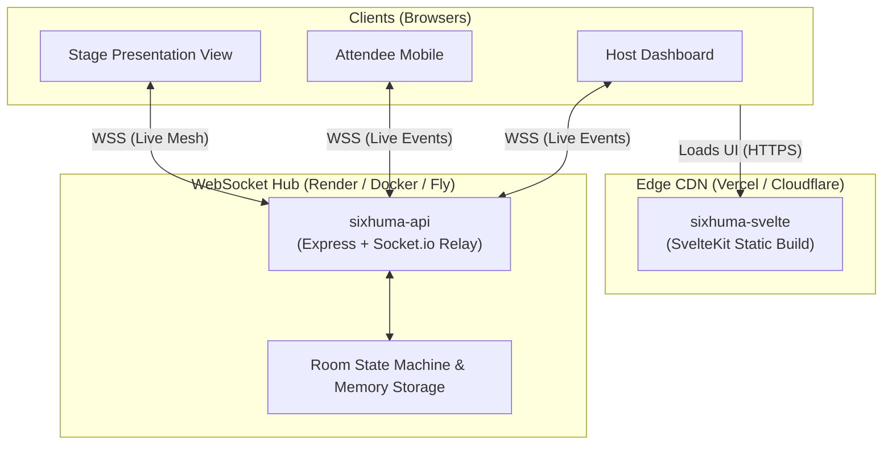

<div align="center">

# Sixhuma

**Real-Time Spatial Event Directory & Attendee Mesh**

*Sixhuma* (isiXhosa: *"We connect"*) gives any physical or hybrid gathering a live, interactive attendee constellation. Attendees scan a QR code or enter a 4-letter room code to view profiles, roles, and contacts in real time — with zero app download.

[](LICENSE)
[](https://github.com/Abez-B/Sixhuma/actions)
[](https://svelte.dev)
[](https://www.typescriptlang.org/)
[](https://socket.io/)
[](https://nodejs.org/)
[](https://github.com/Abez-B/Sixhuma/pulls)

[Live Demo](https://sixhuma.vercel.app) · [Report Bug](https://github.com/Abez-B/Sixhuma/issues) · [Request Feature](https://github.com/Abez-B/Sixhuma/issues)

</div>

---

## ⚡ The Problem & The Solution

| The Old Way | The Sixhuma Way |
| :--- | :--- |
| Handing out paper badges with tiny printed text | Interactive digital attendee cards updated live |
| Forcing attendees to install an 80MB conference app | Instant browser load in < 2 seconds via QR or 4-letter code |
| Manual, lost business cards & LinkedIn searching | 1-click vCard (`.vcf`) contact export straight to phone contacts |
| Static auditorium slides | Live stage view showing attendee nodes joining in real time |
| Clumsy attendee management | Host dashboard with admission waiting room, role badges, & kick controls |

---

## ✨ Features

- **🪐 Interactive Attendee Radar**: Physics-based celestial force graph displaying all room participants floating in real-time orbits around the host and speakers.
- **⚡ Instant Zero-App Entry**: Attendees simply enter a 4-letter code (e.g. `DDMR`) or scan the stage QR code.
- **🛡️ Host Command Dashboard**: Manage waiting room lobbies, assign roles (*Host*, *Speaker*, *Organizer*, *Attendee*), broadcast announcements, and moderate participants.
- **📺 Stage Presentation Mode**: Big-screen projector view with high-contrast, room-scannable QR code and dynamic live participant counts.
- **💬 Real-Time Messaging & Reactions**: Ephemeral global room chat, peer-to-peer DMs, and floating emoji bursts.
- **📇 Universal Contact Export**: Export attendee details directly to your mobile address book via standardized vCard (`.vcf`) or CSV.
- **🎵 Harmonic Web Audio Synthesis**: Zero external audio dependencies — programmatic harmonic chimes for joins, messages, announcements, and reactions.

---

## 🏗️ Architecture

Sixhuma is built as a high-performance TypeScript monorepo powered by `pnpm` workspaces:

```
sixhuma/
├── sixhuma-svelte/       # SvelteKit + Svelte 5 frontend (adapter-static)
├── sixhuma-api/          # Node.js + Express + Socket.io WebSocket relay
├── sixhuma-core/         # Shared state machine, client SDK, and TypeScript types
└── scripts/              # Workspace automation & tooling
```



---

## 🚀 Quickstart (Local Development)

### Prerequisites

- **Node.js**: `v20.0.0` or higher (`v22.x` recommended)
- **pnpm**: `v10.x` or higher (`npm install -g pnpm`)

### 1. Clone & Install

```bash
git clone https://github.com/Abez-B/Sixhuma.git
cd Sixhuma
pnpm install
```

### 2. Start Development Servers

Run both the frontend and WebSocket API concurrently:

```bash
pnpm run dev
```

- **Frontend**: [http://localhost:5173](http://localhost:5173)
- **API / WebSocket Relay**: [http://localhost:3000](http://localhost:3000)

### 3. Run Tests & Validation

```bash
pnpm run typecheck    # Validate TypeScript across all packages
pnpm run test         # Run Vitest test suites (27 unit tests)
pnpm run build        # Build static production bundles
```

---

## 🌐 100% Free Deployment Guide (No Credit Card Required)

Sixhuma is designed to run entirely on free cloud tiers with zero credit card needed:

### Step 1: Deploy Backend WebSocket Hub on [Render.com](https://render.com) (Free)
1. Sign up on [Render.com](https://render.com) with your GitHub account.
2. Click **New +** → **Blueprint** → Select your `Sixhuma` repository.
3. Render automatically reads [`render.yaml`](render.yaml) and provisions a free Web Service with native WebSocket support.
4. Note your deployed API URL (e.g., `https://sixhuma-api.onrender.com`).

### Step 2: Deploy Frontend on [Vercel](https://vercel.com) or [Cloudflare Pages](https://pages.cloudflare.com) (Free)
1. Sign up on [Vercel.com](https://vercel.com) with GitHub.
2. Click **Add New Project** → Import `Sixhuma`.
3. Configure the project:
   - **Root Directory**: `sixhuma-svelte`
   - **Framework Preset**: `SvelteKit`
   - **Environment Variable**: `VITE_HUB_URL` = `https://sixhuma-api.onrender.com` (from Step 1)
4. Click **Deploy**. Your app is live with global edge caching and free SSL.

---

## 🐳 Docker Deployment

To run the entire Sixhuma stack locally or on a VPS using Docker:

```bash
docker compose up --build
```

- Web UI: `http://localhost:5173`
- API / WebSocket: `http://localhost:3000`

---

## ⚙️ Configuration & Environment Variables

### `sixhuma-api`

| Variable | Description | Default |
| :--- | :--- | :--- |
| `PORT` | Listening HTTP/WS port | `3000` |
| `NODE_ENV` | Runtime environment (`development`, `production`) | `development` |
| `ALLOWED_ORIGIN` | Permitted CORS origins for socket & REST endpoints | `*` |
| `DATA_DIR` | Storage path for meeting room JSON snapshots | `./data` |

### `sixhuma-svelte`

| Variable | Description | Default |
| :--- | :--- | :--- |
| `VITE_HUB_URL` | WebSocket server URL | `http://localhost:3000` in dev |
| `VITE_MOCK_MODE` | Set `true` to run offline without a real backend | `false` |

---

## 🤝 Contributing

Contributions are what make the open-source community such an amazing place to learn, inspire, and create. Any contributions you make are **greatly appreciated**.

1. Fork the Project
2. Create your Feature Branch (`git checkout -b feature/AmazingFeature`)
3. Commit your Changes (`git commit -m 'feat: add some AmazingFeature'`)
4. Push to the Branch (`git push origin feature/AmazingFeature`)
5. Open a Pull Request

---

## 📄 License

Distributed under the MIT License. See [`LICENSE`](LICENSE) for more information.

---

## 👨‍💻 Creator & Support

Created with care by **[Bharath](https://bharath.is-cool.dev/)**.

If you find Sixhuma useful for your meetups, conferences, or demo days, consider supporting:

[](https://buymeacoffee.com/abhrams)
